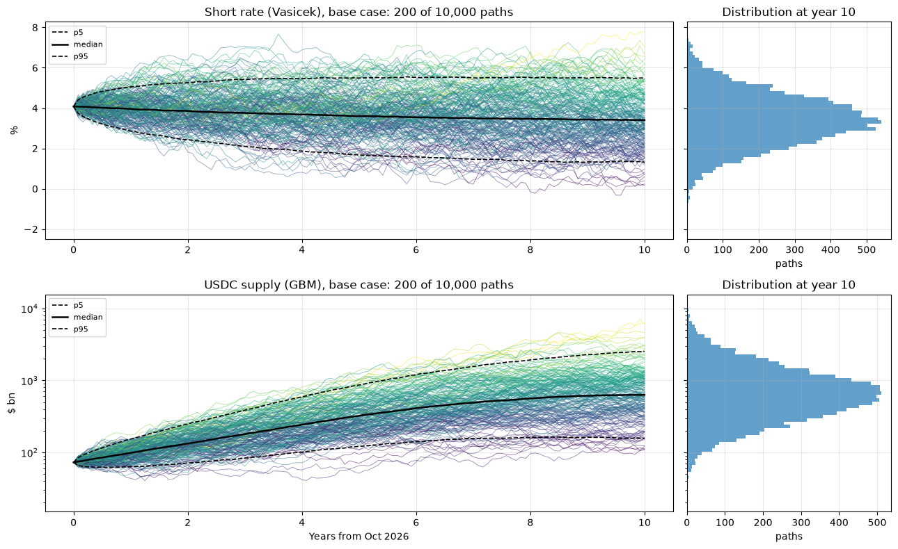
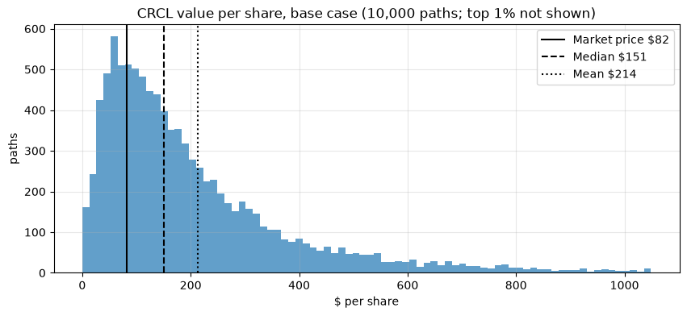

# Circle (CRCL) Valuation with Stochastic Interest Rates and USDC Supply

A stochastic DCF of Circle Internet Group (NYSE: CRCL), the issuer of the USDC stablecoin. Circle earns the interest on the reserves backing USDC, so its value depends on two uncertain variables: interest rates and the amount of USDC in circulation. The model simulates both as correlated stochastic processes, values the company on each simulated path, and then reverses the problem to ask what the market price implies.



**Question.** How much is Circle worth when its revenue depends on stochastic interest rates and USDC supply, and which rate path and USDC growth does the share price imply?

**Answer.** At $82.22 (16 October 2026), the market prices USDC growth of about **24% a year to 2030** at the Fed's projected rate path, roughly 60% of Circle's 40% target. If the target were met, the model values the share at **$214 on average (median $151)**.

| Key result | Value |
|---|---|
| Value per share, base case: mean / median | $214 / $151 |
| 90% range of value per share (base case) | $29 to $616 |
| Paths below the market price (base case) | 26% |
| USDC growth to 2030 implied by the price (Fed rate 3.2%) | 24.0% a year |
| Long-run rate that would justify the price with 40% growth | 0.63% |
| Implied return at $82.22: base case / no USDC growth | 17.7% / 4.7% a year |



All data are cut at 17 October 2026.

## Report

**[Valuation note (PDF, 5 pages)](report/CRCL_valuation_report.pdf)**: summary, business model, model, results, sensitivity and limitations.

The full analysis, with code, interpretation of every step and validation, is in **[the notebook](notebooks/circle_valuation.ipynb)**.

## Methods

### Stochastic calculus and simulation

| Technique | What it does in this model |
|---|---|
| **Brownian motion** | Source of randomness: independent random shocks drive the short rate and the USDC supply over time. |
| **Vasicek model** (stochastic differential equation) | Short rate `dr = κ(θ − r)dt + σ dW`, mean-reverting to a long-run level θ. Calibrated by AR(1) regression on the 3-month T-bill (2000–2026) and anchored on the Fed's long-run projection; simulated with its exact discrete solution. |
| **Geometric Brownian motion** with time-varying drift | USDC supply `dS = μ(t)S dt + σS dW`, with growth scenarios to 2030 (0%, 40%, 56% a year) that fade to 4% a year by year 10. |
| **Itô's lemma** | Gives the exact solution of the GBM, `S(t) = S(0)·exp(∫μ ds − σ²t/2 + σW(t))`, including the −σ²/2 correction, used for an exact simulation step and to calibrate μ. |
| **Cholesky decomposition** | Correlates the two Brownian motions (ρ = −0.27, estimated from monthly data since 2022). |
| **Monte Carlo simulation** | 10,000 monthly paths over 10 years; each path becomes a full set of cash flows and a value per share, giving a distribution instead of a single number. |
| **Validation against closed form** | Simulated means and variances match the exact formulas (all z-scores below 3), and Monte Carlo zero-coupon bond prices match the Vasicek bond formula. |
| **Root finding (Brent's method)** | Solves the full Monte Carlo model for the long-run rate, USDC growth and return that make the model value equal the market price. |

### Valuation and finance

| Technique | What it does in this model |
|---|---|
| **Unit economics** | Reserve income = USDC × short rate; partners (mainly Coinbase) take 61.5%; what remains must cover about $1 bn a year of operating costs. |
| **Free cash flow to the firm (FCFF)** | Annual operating cash flow after tax on each simulated path. |
| **CAPM** | Cost of equity of 10.41% (= WACC, as Circle has no debt), with a regression beta shrunk toward 1.0 by the Vasicek (1973) adjustment. |
| **Discounted cash flow (DCF)** | Present value of 10 years of FCFF plus a Gordon terminal value, then the bridge to value per diluted share. |
| **Reverse DCF** | Instead of asking what the share is worth, asks what the price implies for USDC growth, interest rates and expected return. |
| **Scenario and sensitivity analysis** | Rate and USDC scenarios, a tornado chart of the main assumptions, and a rate-cut scenario. |

## Data

| Data | Source |
|---|---|
| CRCL share price and S&P 500 (for beta) | Yahoo Finance (yfinance) |
| 3-month T-bill (DTB3) and 10-year Treasury yield (DGS10) | FRED, Federal Reserve Bank of St. Louis |
| USDC supply | DefiLlama |
| Circle quarterly results, balance sheet and shares | Circle 8-K earnings releases and 10-Q (SEC) |
| Fed rate, GDP and inflation projections | FOMC Summary of Economic Projections, September 2026 |
| Equity risk premium and US marginal tax rate | Damodaran (October 2026 and January 2026 updates) |
| Stablecoin market forecast | Standard Chartered (14 October 2026) |

## Repository structure

```
circle-valuation/
├── notebooks/circle_valuation.ipynb   full analysis (sections 1-8)
├── report/CRCL_valuation_report.pdf   5-page valuation note
├── report/figures/                    figures used in this README
├── data/                              market data saved by the notebook (cut at 17 Oct 2026)
├── requirements.txt
└── README.md
```

## How to run

```bash
git clone https://github.com/ChristopheAbelem/circle-valuation.git
cd circle-valuation
python -m venv .venv && source .venv/bin/activate
pip install -r requirements.txt
jupyter notebook notebooks/circle_valuation.ipynb
```

Tested with Python 3.14 and the package versions in `requirements.txt`. Run all cells in order (Kernel > Restart and Run All). The notebook downloads the market data, cuts it at 17 October 2026 and reproduces every result in about one minute. The random seed is fixed; small differences can appear only if a data provider later revises its history. The CSV files in `data/` are the exact CRCL price, T-bill, USDC and quarterly series used for the results in the report.

## Limitations

The main ones, discussed in the report and in section 8 of the notebook: USDC growth scenarios rest on Circle's target and a bank forecast rather than on estimates; the cost elasticity comes from a single comparable period; the beta rests on 16 months of trading; the discount rate is fixed while rates are stochastic; and Circle has only five quarters of public results.

---

Christophe Abelem, Computer Engineering, CESUPA (Belém, Brazil). Academic portfolio project. Not investment advice.
